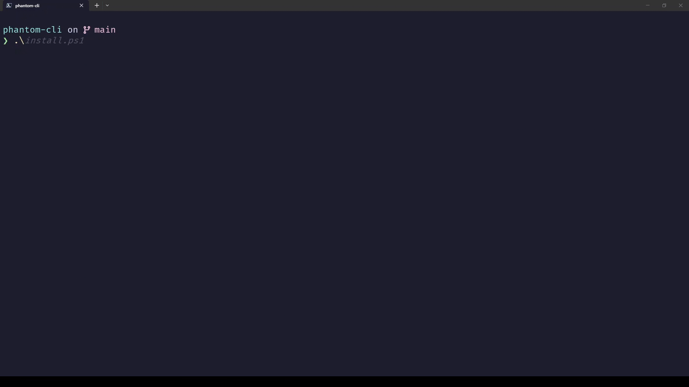
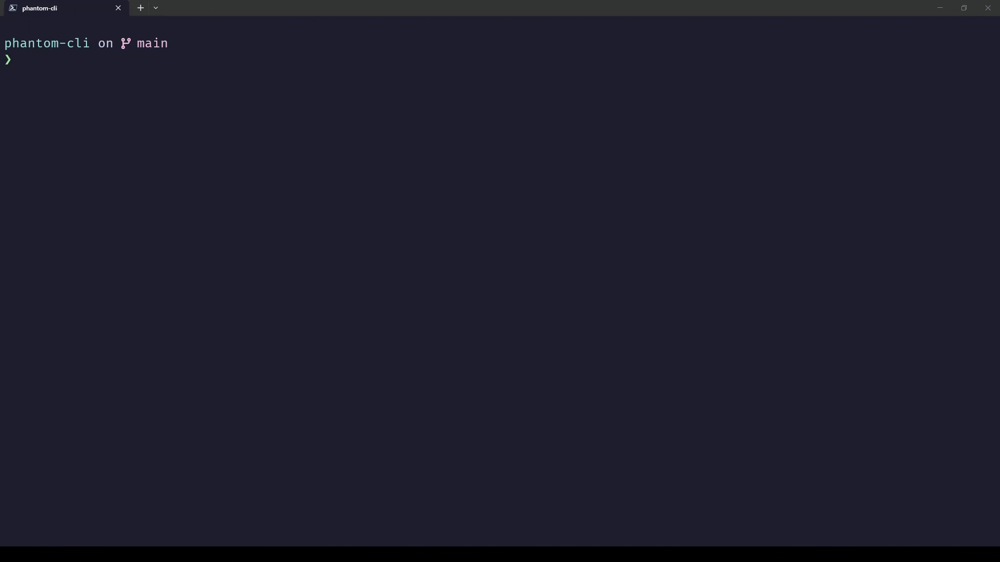

# 👻 phantom-cli
> *A haunted terminal hook that "possesses" your shell, turning mundane commands into eerie, context-aware commentary from a sentient digital ghost.*

Built for the **Hacktoberfest Week 4 Challenge: Ghost in the Machine**.

## 🔮 What is `phantom-cli`?
`phantom-cli` is a lightweight, cross-platform terminal pranking utility. When you or an unsuspecting friend run familiar shell commands like `ls`, `dir`, or `cd`, the terminal executes its normal tasks while silently pinging a cloud-hosted open-weight AI model in the background. 

Within seconds, an ancient, glitchy "phantom" trapped inside the operating system whispers a spooky, personalized response reacting directly to the command you typed and the folder you are currently viewing!

## Demo



## ✨ Features
* **Cross-Platform Support:** Includes native installation scripts for **Windows (PowerShell)** and **Linux/macOS (Bash/Zsh)**.
* **Zero-Dependency Architecture:** Requires no external programming languages (like Python or Node) or heavy packages. It relies entirely on native OS tools (`Invoke-RestMethod` and `curl`).
* **Pre-flight API Verification:** Interactive installation scripts securely test your API connection and model choice *before* modifying any configuration files.
* **Context-Aware Hauntings:** Packages your current directory path and command type into a live payload for dynamic, highly personalized ghost dialogue.
* **Non-Blocking Execution:** Background requests ensure your terminal workflow remains fast and responsive without annoying lag.


## 🛠️ Quick Installation
### 🌀 Windows (PowerShell)
1. Open PowerShell as a standard user.
2. Run the Windows installation script:
   ```powershell
   Set-ExecutionPolicy -ExecutionPolicy Bypass -Scope Process
   ./install.ps1
    ```
3. Enter your Groq API key and preferred open-weight model name when prompted. The script will verify the connection and inject the haunted hook into your `$PROFILE`.
4. Restart your terminal session!

### 🐧 Linux / macOS (Bash / Zsh)
1. Open your terminal.
2. Run the Unix installation script:
    ```bash
    bash install.sh
    ```
3. Enter your API key and model name. Once verified, reload your shell configuration:
    ```bash
    source ~/.bashrc  # or source ~/.zshrc depending on your shell
    ```
---